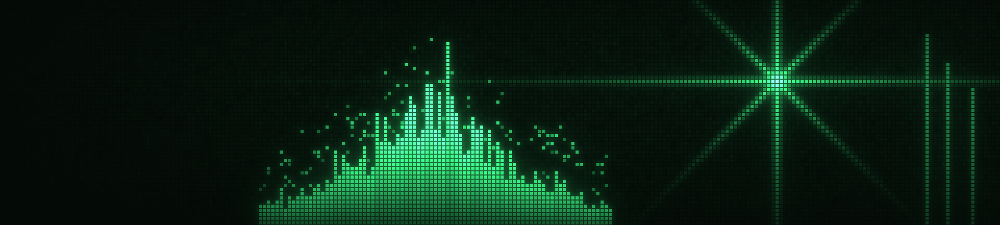
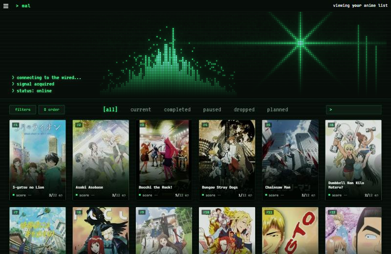

<div align="center">



# wardrobe

**a wardrobe of free themes for the corners of the internet i hang out in**


<sub>pt-br · <a href="README.pt-BR.md">leia em português</a></sub>

</div>

<br/>

## ⌇── the wardrobe ──⌇

Every theme here is free to use and change. Each one has its own install steps.

<table>
  <tr>
    <th>preview</th>
    <th>theme</th>
  </tr>
  <tr>
    <td width="55%">
      <a href="mal/wired"></a>
    </td>
    <td>
      <h3><a href="mal/wired">Wired</a></h3>
      <sub>MyAnimeList · anime &amp; manga lists</sub>
      <br/><br/>
      Green phosphor on black, a boot log over your banner and cards that light up like an old CRT. Inspired by <i>Serial Experiments Lain</i>.
      <br/><br/>
      <a href="mal/wired#install"><b>> install</b></a>
    </td>
  </tr>
</table>

<br/>

## ⌇── what's on the rack ──⌇

```
wardrobe/
└── mal/
    └── wired/
        ├── wired.css     the theme, paste it into MAL
        ├── banner.py     makes green LED banners from any picture
        ├── banner.png    the default banner
        └── preview.png   what it looks like
```

More themes (and more sites) will show up here over time.

<br/>

## ⌇── something broke? ──⌇

Sites change their layout every now and then, so a theme can break out of nowhere. If yours looks off:

- **[report a bug](https://github.com/romugaboo/wardrobe/issues/new?template=bug.yml)** · a screenshot and a link to your list help a lot
- **[suggest an idea](https://github.com/romugaboo/wardrobe/issues/new?template=idea.yml)** · new options, tweaks or a theme for another site
- **no github account?** · email me at [hi.romugaboo@proton.me](mailto:hi.romugaboo@proton.me)

English or Portuguese, both are fine.

<br/>

## ⌇── license ──⌇

[MIT](LICENSE). Themes built on someone else's work credit them in their own license file.

<br/>

<div align="center">
<sub>made with love by <a href="https://romugaboo.github.io">romugaboo</a> from brazil ✧ silly online ♡</sub>
</div>
