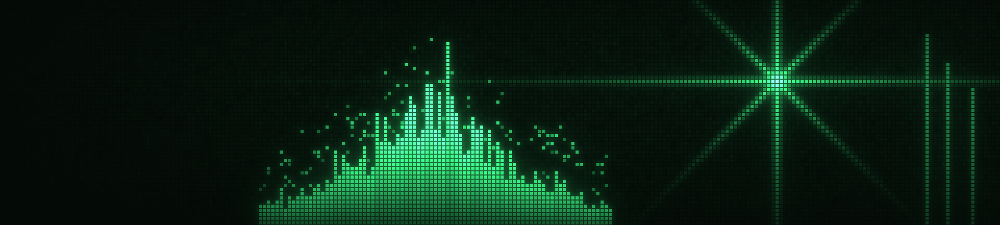
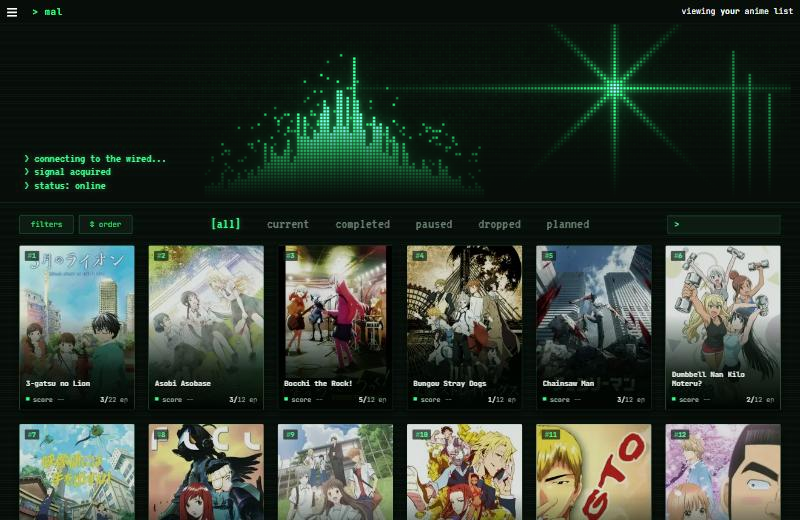

<div align="center">



# wardrobe

**um guarda-roupa de temas gratuitos pros cantinhos da internet onde eu vivo**


<sub>en · <a href="README.md">read in english</a></sub>

</div>

<br/>

## ⌇── o guarda-roupa ──⌇

Todo tema aqui é livre pra usar e mudar. Cada um tem o seu passo a passo de instalação.

<table>
  <tr>
    <th>prévia</th>
    <th>tema</th>
  </tr>
  <tr>
    <td width="55%">
      <a href="mal/wired/README.pt-BR.md"></a>
    </td>
    <td>
      <h3><a href="mal/wired/README.pt-BR.md">Wired</a></h3>
      <sub>MyAnimeList · listas de anime e mangá</sub>
      <br/><br/>
      Verde fósforo no preto, um boot log em cima do banner e cards que acendem como um CRT antigo. Inspirado em <i>Serial Experiments Lain</i>.
      <br/><br/>
      <a href="mal/wired/README.pt-BR.md#instalar"><b>> instalar</b></a>
    </td>
  </tr>
</table>

<br/>

## ⌇── o que tem no cabide ──⌇

```
wardrobe/
└── mal/
    └── wired/
        ├── wired.css     o tema, é só colar no MAL
        ├── banner.py     transforma qualquer imagem num banner de LED verde
        ├── banner.png    o banner padrão
        └── preview.png   como ele fica
```

Mais temas (e mais sites) vão aparecendo por aqui com o tempo.

<br/>

## ⌇── quebrou alguma coisa? ──⌇

Os sites mudam o layout de vez em quando, então um tema pode quebrar do nada. Se o seu ficou estranho:

- **[reportar um bug](https://github.com/romugaboo/wardrobe/issues/new?template=bug.yml)** · um print e o link da sua lista ajudam muito
- **[sugerir uma ideia](https://github.com/romugaboo/wardrobe/issues/new?template=idea.yml)** · opções novas, ajustes ou um tema pra outro site
- **não tem conta no github?** · me manda um e-mail em [hi.romugaboo@proton.me](mailto:hi.romugaboo@proton.me)

Pode escrever em português, tá tudo bem!

<br/>

## ⌇── licença ──⌇

[MIT](LICENSE). Temas feitos em cima do trabalho de outra pessoa dão o crédito no próprio arquivo de licença.

<br/>

<div align="center">
<sub>made with love by <a href="https://romugaboo.github.io">romugaboo</a> from brazil ✧ silly online ♡</sub>
</div>
