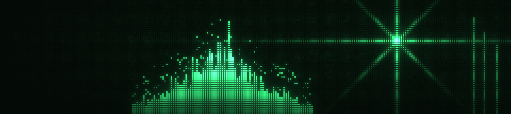
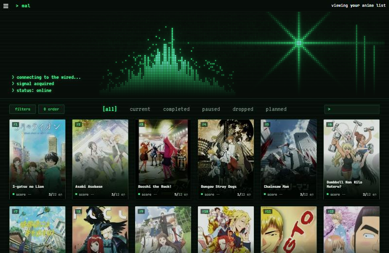

<div align="center">



# Wired

**a MyAnimeList theme for people who live in the wired**


<sub>pt-br · <a href="README.pt-BR.md">leia em português</a></sub>

</div>

```
> connecting to the wired...
> signal acquired
> status: online
```



<br/>

## ⌇── layer 01 : features ──⌇

- monospace text, a CRT font on the status tabs and a blinking `> mal_` in the header
- a boot message over your cover, with a slow band of light moving down it
- faint scanlines across the page, behind the cards
- covers slightly desaturated so they sit well on the dark background
- thin card frames that light up on hover, with details as `key / value`
- a colored square on each card for its status (current, completed, paused, dropped, planned)
- green "top rated" badges for scores of 8, 9 and 10

<br/>

## ⌇── layer 02 : install ──⌇ <a name="install"></a>

1. On MAL, open **List Settings → List Style Design** and pick any **Modern** theme.
2. Click **Add Custom CSS**, clear the box and paste the whole [`wired.css`](wired.css).
3. *(optional)* Upload a **cover image**. No cover? You get the default banner above. Dark pictures look best.
4. Save.

<br/>

## ⌇── layer 03 : make it yours ──⌇

The options are in the `OPTIONS` block at the top of [`wired.css`](wired.css).

| option | what it does | default |
|---|---|---|
| `--boot-text` | the message over your banner, `\A` breaks a line | 3 lines of boot log |
| `--bannerHeight` | banner height relative to page width | `0.22` |
| `--defaultBanner` | image used when there's no cover, `none` for plain dark | the Wired banner |
| `--coverTint` | how much covers lean green, `0` keeps them natural | `0.1` |
| `--coverSaturation` | cover color intensity | `0.82` |
| `--accent`, `--bg`, `--text` | main colors, as `hue, saturation, lightness` | phosphor green on black |
| `--toggleStats`, `--toggleStreaming`, `--toggleRating8/9/10` | set to `hidden` to turn things off | `visible` |

After editing, paste the file into MAL again and save.

> [!TIP]
> Don't add an `@import` to the file. When the CSS has one, MAL hides the whole theme from everyone but you, so your list looks fine on your account and plain to visitors. The fonts come in through `@font-face`, but MAL only lets them load for you. Visitors see a monospace font from their own system instead.

<br/>

## ⌇── layer 04 : your own LED banner ──⌇

Turn any picture into a banner in the same green LED style:

```
py banner.py my-picture.jpg my-banner.png --shape square
```

| flag | effect |
|---|---|
| `--shape` | `round`, `square` or `circle` LEDs |
| `--cell` | LED size in pixels, smaller means more detail (default `8`) |
| `--contrast` | punchier light and darker shadows (default `1.4`) |
| `--cut` | pushes mid-tones like a busy sky into the dark (default `0.5`) |
| `--center` | crop position, `0` top to `1` bottom (default `0.5`) |
| `--invert` | swaps light and dark |
| `--keep-left` | keeps the left side lit (it's dimmed so the boot log stays readable) |

Needs Python with `numpy` and `Pillow`. Run it from this folder.

<br/>

## ⌇── layer 05 : credits ──⌇

Built on top of [Brink](https://github.com/ValerioLyndon/MAL-Public-List-Designs) by Valerio Lyndon (MIT), interface icons included. See [LICENSE](LICENSE).
The default banner is original art, drawn by `py banner.py --default banner.png`.

<br/>

Something looks broken? [Open a bug report](https://github.com/romugaboo/wardrobe/issues/new?template=bug.yml) or email [hi.romugaboo@proton.me](mailto:hi.romugaboo@proton.me). English or Portuguese, both are fine.

<br/>

<div align="center">
<sub>present day, present time · made with love by <a href="https://romugaboo.github.io">romugaboo</a> from brazil ✧ silly online ♡</sub>
</div>
