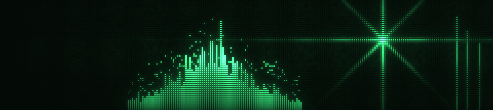
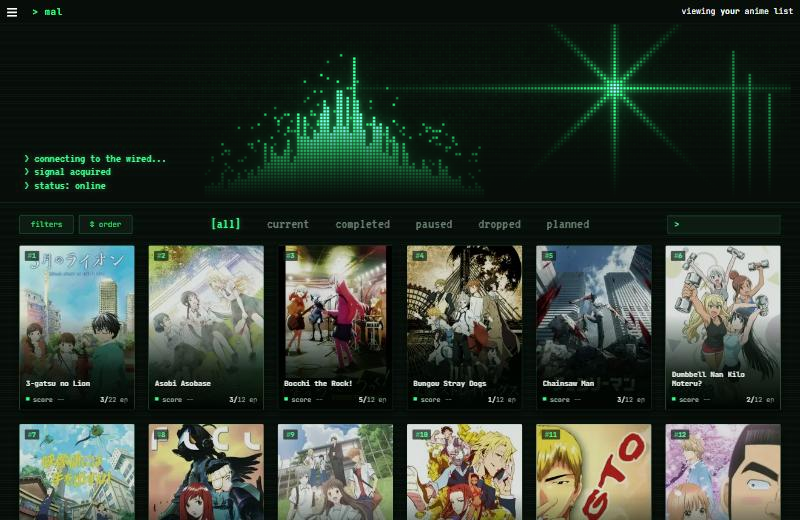

<div align="center">



# Wired

**um tema de MyAnimeList pra quem vive na wired**


<sub>en · <a href="README.md">read in english</a></sub>

</div>

```
> connecting to the wired...
> signal acquired
> status: online
```



<br/>

## ⌇── layer 01 : o que tem ──⌇

- texto monoespaçado, fonte de CRT nas abas de status e um `> mal_` piscando no topo
- uma mensagem de inicialização em cima da sua capa, com uma faixa de luz descendo devagar
- scanlines bem fininhas pela página, atrás dos cards
- capas um pouco menos saturadas pra combinar com o fundo escuro
- molduras finas nos cards que acendem no hover, com os detalhes no formato `chave / valor`
- um quadradinho colorido em cada card com o status (assistindo, completo, pausado, dropado, planejado)
- selos verdes de "top rated" pras notas 8, 9 e 10

<br/>

## ⌇── layer 02 : instalar ──⌇ <a name="instalar"></a>

1. No MAL, abre **List Settings → List Style Design** e escolhe qualquer tema **Modern**.
2. Clica em **Add Custom CSS**, apaga o que tiver lá e cola o [`wired.css`](wired.css) inteiro.
3. *(opcional)* Sobe uma **cover image**. Sem capa, aparece o banner padrão aí de cima. Imagens escuras ficam melhores.
4. Salva.

<br/>

## ⌇── layer 03 : deixa com a sua cara ──⌇

As opções ficam no bloco `OPTIONS`, no começo do [`wired.css`](wired.css).

| opção | o que faz | padrão |
|---|---|---|
| `--boot-text` | a mensagem em cima do banner, `\A` quebra a linha | 3 linhas de boot log |
| `--bannerHeight` | altura do banner em relação à largura da página | `0.22` |
| `--defaultBanner` | imagem usada quando não tem capa, `none` deixa só o escuro | o banner do Wired |
| `--coverTint` | o quanto as capas puxam pro verde, `0` deixa natural | `0.1` |
| `--coverSaturation` | intensidade das cores das capas | `0.82` |
| `--accent`, `--bg`, `--text` | cores principais, no formato `matiz, saturação, luminosidade` | verde fósforo no preto |
| `--toggleStats`, `--toggleStreaming`, `--toggleRating8/9/10` | coloca `hidden` pra desligar | `visible` |

Editou? Cola o arquivo de novo no MAL e salva.

> [!TIP]
> Não coloca `@import` no arquivo. Quando o CSS tem um, o MAL esconde o tema inteiro de todo mundo menos de você, aí a lista fica certinha na sua conta e sem tema pra quem visita. As fontes entram por `@font-face`, mas o MAL só deixa elas carregarem pra você. Quem visita vê uma fonte monoespaçada do próprio sistema.

<br/>

## ⌇── layer 04 : o seu banner de LED ──⌇

Transforma qualquer imagem num banner no mesmo estilo de LED verde:

```
py banner.py minha-imagem.jpg meu-banner.png --shape square
```

| opção | efeito |
|---|---|
| `--shape` | LEDs `round` (arredondados), `square` (quadrados) ou `circle` (bolinhas) |
| `--cell` | tamanho do LED em pixels, menor = mais detalhe (padrão `8`) |
| `--contrast` | luz mais forte e sombras mais escuras (padrão `1.4`) |
| `--cut` | joga os tons médios, tipo um céu cheio de nuvem, pro escuro (padrão `0.5`) |
| `--center` | posição do corte, de `0` (topo) a `1` (base) (padrão `0.5`) |
| `--invert` | inverte claro e escuro |
| `--keep-left` | mantém o lado esquerdo aceso (ele escurece pro boot log ficar legível) |

Precisa de Python com `numpy` e `Pillow`. Roda de dentro desta pasta.

<br/>

## ⌇── layer 05 : créditos ──⌇

Feito em cima do [Brink](https://github.com/ValerioLyndon/MAL-Public-List-Designs), do Valerio Lyndon (MIT), incluindo os ícones da interface. Veja a [LICENSE](LICENSE).
O banner padrão é arte original, desenhada com `py banner.py --default banner.png`.

<br/>

Alguma coisa quebrou? [Abre um bug report](https://github.com/romugaboo/wardrobe/issues/new?template=bug.yml) ou manda um e-mail pra [hi.romugaboo@proton.me](mailto:hi.romugaboo@proton.me). Pode escrever em português!

<br/>

<div align="center">
<sub>present day, present time · made with love by <a href="https://romugaboo.github.io">romugaboo</a> from brazil ✧ silly online ♡</sub>
</div>
